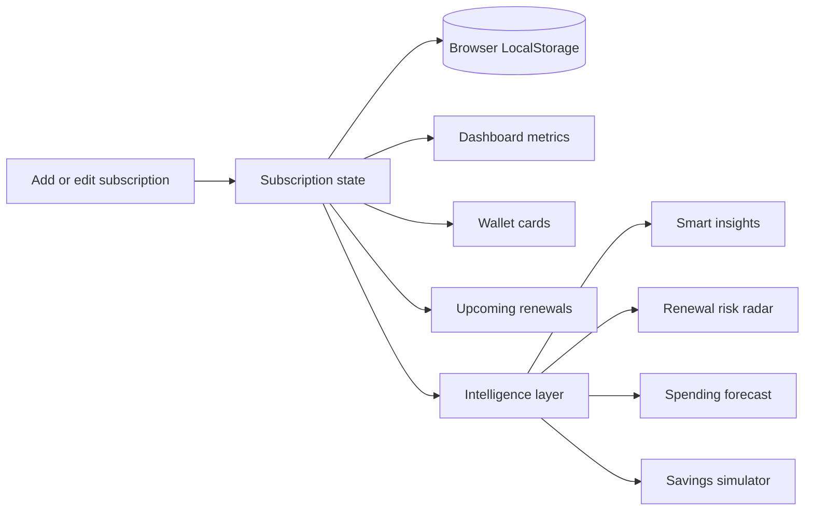
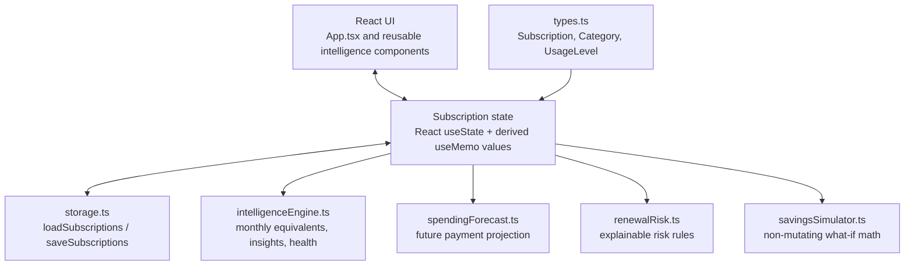

# SubWallet

> A premium, card-based subscription wallet for understanding recurring spending in Indian Rupees.

SubWallet is a mobile-responsive React application that helps people see, manage, and reason about recurring subscriptions without the feel of a traditional admin dashboard. It combines a wallet-style interface with explainable spending intelligence, renewal risk signals, forecasts, and a non-mutating savings simulator.


## Product snapshot



### What it supports

- Dashboard monthly spend, annual run rate, active subscription count, and category spending.
- Wallet cards with INR price, billing cadence, category, renewal date, status, and color.
- Add, edit, pause, resume, and delete subscription records.
- Search, category filters, and active/paused filters.
- Chronologically sorted upcoming payments.
- LocalStorage persistence with no account or backend required.
- Smart insights based on the records in the wallet.
- Rule-based renewal risk analysis with Low, Medium, and High severity.
- 7-day, 30-day, 90-day, and 12-month spending forecasts.
- What-if savings simulation that never mutates the real wallet.
- Manual usage check-ins: frequently, occasionally, or rarely used.

## Design principles

SubWallet is intentionally designed as a personal financial wallet rather than a CRUD table:

1. **Calm hierarchy** — the monthly number and the next renewal are immediately visible.
2. **Card-based interaction** — each subscription feels like a wallet item.
3. **Explainable intelligence** — insights are calculated from visible records and use rules users can understand.
4. **INR-first** — every financial display uses Indian formatting through `Intl.NumberFormat('en-IN', { currency: 'INR' })`.
5. **Local by default** — the MVP stores data in the current browser and does not transmit it to a service.

## Architecture



### Source map

| Area | Location | Responsibility |
| --- | --- | --- |
| Application shell | [`src/App.tsx`](./src/App.tsx) | Layout, CRUD orchestration, dashboard metrics, search, filters, navigation |
| Data model | [`src/types.ts`](./src/types.ts) | Subscription and category TypeScript types |
| Persistence | [`src/storage.ts`](./src/storage.ts) | LocalStorage serialization and seed data |
| Styling | [`src/styles.css`](./src/styles.css) | Dark fintech design system and responsive layout |
| Intelligence UI | [`src/features/intelligence/components/`](./src/features/intelligence/components/) | Insights, forecast, health, risk, and savings views |
| Intelligence calculations | [`src/features/intelligence/`](./src/features/intelligence/) | Pure, reusable calculation modules |
| Tests | [`src/features/intelligence/intelligence.test.ts`](./src/features/intelligence/intelligence.test.ts) | Calculation and intelligence coverage |

## Data model

```ts
type Subscription = {
  id: string
  name: string
  category: 'Entertainment' | 'Productivity' | 'Fitness' | 'Utilities' | 'Other'
  price: number
  billing: 'weekly' | 'monthly' | 'quarterly' | 'yearly'
  nextRenewal: string // YYYY-MM-DD
  color: string
  status: 'active' | 'paused'
  usage?: 'frequent' | 'occasional' | 'rare'
}
```

All totals are derived from the records currently in state. Paused subscriptions remain visible in the wallet but are excluded from active recurring expenditure and forecasts.

## Billing calculations

| Billing cycle | Monthly equivalent |
| --- | ---: |
| Weekly | `amount × 52 ÷ 12` |
| Monthly | `amount` |
| Quarterly | `amount ÷ 3` |
| Yearly | `amount ÷ 12` |

Annualized expenditure is `monthly equivalent × 12`. Currency is formatted with Indian grouping, for example `₹1,299` and `₹1,25,000`.

## Getting started

### Requirements

- Node.js 18 or newer
- npm 9 or newer
- Git (only needed for contributing)

### Install on Windows PowerShell

From the repository folder:

```powershell
cd C:\Users\Ajvad\Downloads\SubWalllet\SubWallet
npm install
```

### Start the development server

```powershell
npm run dev
```

Open the local URL printed by Vite, usually `http://localhost:5173`.

### Run the production build

```powershell
npm run build
```

The build runs TypeScript project checks before creating the production bundle in `dist/`.

### Run tests

```powershell
npm test
```

### Preview the production build

```powershell
npm run build
npm run preview
```

## LocalStorage behaviour

The app persists subscriptions under the `subwallet-subscriptions-v2` key. Data is written whenever subscription state changes and loaded when the app starts. To reset the demo data during development, open browser DevTools and run:

```js
localStorage.removeItem('subwallet-subscriptions-v2')
location.reload()
```

This removes only the local wallet in the current browser profile.

## Quality checklist

Before committing a change, run:

```powershell
npm test
npm run build
git status
```

The current project is intentionally backend-free. Authentication, payment processing, bank integrations, notifications, and an external LLM assistant are outside the MVP scope. No API keys are required in the frontend.

## Contributing

The project currently uses direct commits to `main` for the hackathon workflow. Keep changes focused, preserve the wallet visual language, and avoid hardcoding financial totals. When adding a calculation, prefer a pure TypeScript function with a focused test.

```powershell
git add .
git commit -m "Describe the change"
git push origin main
```

## Project documents

- [Product requirements](./PRD.md)
- [Implementation notes](./IMPLEMENTATION.md)

## License

This repository is a hackathon MVP. Add the project license here before public distribution.
